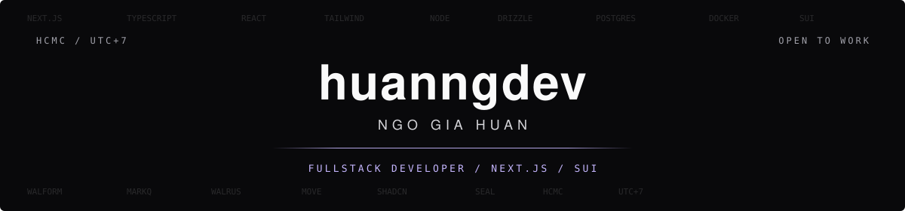

 

<picture>
  <source media="(prefers-color-scheme: dark)" srcset="https://readme-typing-svg.demolab.com?font=JetBrains+Mono&weight=500&size=15&pause=1600&color=E6EDF3&center=true&vCenter=true&width=760&height=32&lines=Fullstack+developer+in+Ho+Chi+Minh+City.;Next.js%2C+TypeScript%2C+and+Sui.;WalForm+-+Top+1%2C+Walrus+Session+2." />
  
</picture>

 

## About

Hey, I'm **Huấn** (`huanngdev`) — a fullstack developer in **Ho Chi Minh City**.

I build web products with Next.js and TypeScript, and ship on Sui when the product needs it. Freelance, open to full-time roles — remote, on-site, or hybrid.

  <code></code>
  <code></code>
  <code></code>
  <code></code>

## Selected work

<table>
  <tr>
    <td width="50%" valign="top">
      
<strong><a href="https://walform.wal.app">WalForm</a></strong> &nbsp; <code>TOP 1</code>

      
On-chain form builder, live on Sui mainnet.

      
I owned the frontend: drag-and-drop forms, AI-assisted generation, Seal encryption, and Walrus storage. Walrus Session 2, Form Tooling.

      

        
        
        
        
      

    </td>
    <td width="50%" valign="top">
      
<strong><a href="https://github.com/huanngdev/markq">MarkQ</a></strong> &nbsp; <code>OPEN SOURCE</code>

      
Markdown files become graded quizzes.

      
Answers stay on the server. Attempts autosave. Analytics break results down by topic. MIT.

      

        
        
        
        
      

    </td>
  </tr>
  <tr>
    <td width="50%" valign="top">
      
<strong><a href="https://www.huanngdev.site">huanngdev.site</a></strong> &nbsp; <code>PORTFOLIO</code>

      
The site, plus a public component registry.

      
Tables, media players, and a block editor. The UI work is on the components page.

      

        
        
        
        
      

    </td>
    <td width="50%" valign="top">
      
<strong>Formo</strong> &nbsp; <code>SEP 2025 – MAY 2026</code>

      
Fullstack on a Web3 analytics product.

      
Shipped workspace API keys end to end, the Formo CLI, and an MCP server for project-scoped data.

      

        
        
        
        
      

    </td>
  </tr>
</table>

## Stack

<table width="100%">
  <tr>
    <td width="18%" valign="middle"><strong>FRONTEND</strong></td>
    <td width="82%" valign="middle">
      
      
      
      
      
    </td>
  </tr>
  <tr>
    <td width="18%" valign="middle"><strong>BACKEND</strong></td>
    <td width="82%" valign="middle">
      
      
      
      
      
    </td>
  </tr>
  <tr>
    <td width="18%" valign="middle"><strong>WEB3</strong></td>
    <td width="82%" valign="middle">
      
      
      
      
    </td>
  </tr>
</table>

## Activity

  

  

Refreshed daily by <a href="https://github.com/lowlighter/metrics">lowlighter/metrics</a>.

  Ho Chi Minh City · open to full-time and freelance
    
  <a href="mailto:huanngdev@gmail.com">Email</a>
  &nbsp;&middot;&nbsp;
  <a href="https://www.huanngdev.site">Portfolio</a>
  &nbsp;&middot;&nbsp;
  <a href="https://www.linkedin.com/in/huanngdev/">LinkedIn</a>

