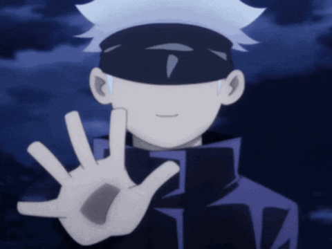

<div align="center">



<a href="https://git.io/typing-svg">
  
</a>

<p>
  <a href="https://www.huanngdev.site"></a>
  <a href="https://www.linkedin.com/in/huanngdev/"></a>
  <a href="mailto:huanngdev@gmail.com"></a>
  <a href="https://steamcommunity.com/profiles/76561199208466836/"></a>
</p>


</div>

## 👁️ About me

<table>
<tr>
<td width="58%" valign="top">

```ts
const huan = {
  role: "Fullstack Developer",
  location: "Ho Chi Minh City, Vietnam 🇻🇳",
  stack: ["Next.js", "TypeScript", "Node.js", "PostgreSQL"],
  web3: ["Sui", "Move", "Walrus"],
  learning: ["System design", "Cybersecurity"],
  hobbies: ["Gaming 🎮", "Anime 🌀"],
  motto: "Ship fast, refactor with Infinity.",
};
```

- 🔭 Building full-stack products end to end, from DB schema to pixel
- 🌱 Currently exploring on-chain apps with **Sui** & **Walrus**
- 💬 Ask me about **Next.js**, **TypeScript**, **Postgres + Drizzle**
- ⚡ Fun fact: my code has *Infinity* — bugs just never reach it (mostly)

</td>
<td width="42%" align="center" valign="middle">
  
  <br/><sub><i>“Don't worry, I'm the strongest.”</i></sub>
</td>
</tr>
</table>

## 🛠️ Tech stack

<div align="center">


<br/>


</div>

## 📊 GitHub stats

<div align="center">










</div>

## 🎮 Off the clock

<div align="center">

<a href="https://steamcommunity.com/profiles/76561199208466836/">
  
</a>

<sub>Refreshed daily from my public Steam profile by a GitHub Action.</sub>

</div>

## 🐍 Contribution snake

<div align="center">

<picture>
  <source media="(prefers-color-scheme: dark)" srcset="https://raw.githubusercontent.com/huanngdev/huanngdev/output/github-snake-dark.svg"/>
  <source media="(prefers-color-scheme: light)" srcset="https://raw.githubusercontent.com/huanngdev/huanngdev/output/github-snake.svg"/>
  
</picture>

</div>

<div align="center">


</div>
